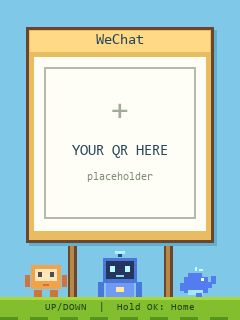
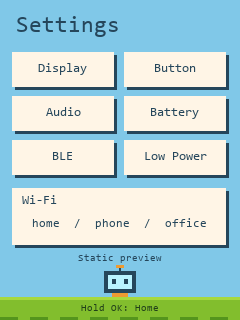

<p align="right"><strong>简体中文</strong> · <a href="README.md">English</a></p>

# Jacky 的口袋小世界 · 静态分享版

用于二次开发的离线口袋名片界面。目标硬件为 FoloToy AI Passport：
ESP32-C3、8 MB Flash、无 PSRAM、240×320 屏幕，使用 **ESP-IDF 5.5.3**。

[在线预览](https://bzbj.github.io/jacky-pocket-world/preview/) ·
[English](README.md)

| 首页 | 微信占位页 | 静态设置 |
| --- | --- | --- |
|  |  |  |

直接用浏览器打开 [preview/index.html](preview/index.html) 即可查看三个界面。
网页与固件使用同一组屏幕图，不需要服务器、JavaScript、账号或联网。

## 保留的界面与操作

- **首页：** Jacky Lin、读书企鹅、三个固定站位的角色。
- **微信：** `YOUR QR HERE` 空白占位框，不含可解码的联系人信息。
- **设置：** 静态菜单。Wi-Fi 仅显示 `home / phone / office` 三个标签，
  没有真实网络名称、密码、连接状态，也不读写设备上已保存的网络。
  菜单项不启动硬件测试功能。

上 / 下键切换首页与微信；首页长按 OK 打开设置；微信或设置长按 OK 返回首页。
短按 OK 保持当前画面。本分享版角色为静态展示，不带动画任务。
固件在电量计可用时显示实际电量，读取失败时不显示虚构数值。

## 编译与检查

激活官方 ESP-IDF 5.5.3 环境后运行：

```sh
idf.py --version
./tools/validate.sh
```

Bash 检查入口依次执行分享文件检查、主机测试、隔离配置编译、合并镜像布局校验、
匹配调试文件归档。主机测试需要 C 编译器；`--static` 和 `--firmware` 可分阶段运行。
Windows 下可通过 Git Bash 配合本机 IDF 工具运行同一入口；普通 Windows IDF
终端也可用 `idf.py build` 做增量开发。

通过校验的完整镜像为 `build/FoloToy-AI-Passport-full.bin`，写入偏移为 `0x0`。
匹配的调试文件位于 `build/firmware/<sha256>/`。
完整镜像适用于空白设备或明确要完整刷新的设备，写入时可能重置 NVS 数据。
已有设备需要保留配置且分区兼容时，使用分段 `idf.py flash`。构建不会自动烧录。

## 修改与分享

`main/navigation.c` 管理翻页；`main/main.c` 负责显示、按键队列和电量读取。
`tools/build_assets.py` 生成三个屏幕 PNG 和 `assets/screens.c`。生成结果已包含在
源码内，普通固件编译不需要 Pillow；修改图稿时才需要：

```sh
python -m pip install Pillow
python tools/build_assets.py
```

可选参数 `--font /path/to/font.ttf` 使用本机字体，不将字体文件打包。
可将首页姓名、图稿与二维码占位框替换为自己的内容。当前布局使用固定角色站位。

分享包不包含实时 Token 统计、Vibe Tree、Codex 连接、语音、云接口、设备密钥、
配网、私人二维码、日志、本机配置、构建产物和 Git 历史。
蓝色角色只作为画面素材出现，不代表存在 Codex 连接。

`public-files.json` 是逐项列出的分享白名单。打包命令为：

```sh
python tools/package_source.py ../jacky-pocket-world-source.zip
```

打包前会检查源码，输出文件已存在时会停止。工具不递归复制工作目录，
不打包固件、NVS 或调试文件。

## 来源与授权范围

BSP 与固件校验工具源自 [FoloToy AI Passport](https://github.com/folotoy/ai-passport)，
保留其 [MIT 许可证](LICENSE)，本版代码沿用 MIT。画面素材单独说明来源，见
[ASSET-NOTICES.zh_CN.md](ASSET-NOTICES.zh_CN.md)。三个角色改为代码绘制的替代形象，
保持原站位；未附带桌面应用角色图集或第三方 Logo 原图。

源码检查与编译不能代替实机验收。实体按键、LCD 显示、电量准确度和硬件兼容性需要单独验证。
